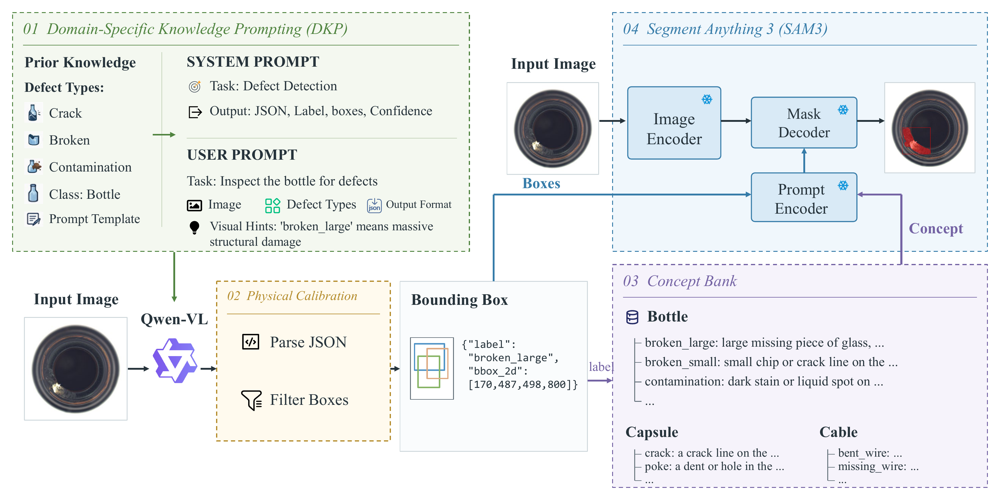

# HSCKAD

**Training-free zero-shot anomaly detection and segmentation with a vision-language
model and a concept-guided promptable segmenter.**

This repository is the reference implementation accompanying a manuscript that is
currently under review. The paper title and the full citation will be added once
the review process is complete.

HSCKAD is a training-free pipeline: a vision-language model proposes candidate
anomaly regions, a category-conditioned semantic resource turns each predicted
defect label into a description of its visible morphology, and a promptable
segmentation model turns the region plus that description into a pixel-accurate
mask. No target-class annotation is used at inference time, no ground-truth box
or mask is ever fed to the model, and neither foundation model is fine-tuned.



*Framework overview (from the manuscript).*

---

## Release status

This is a **partial release**. Only the MVTec-AD pipeline is public at the moment.

The remaining benchmarks, the ablation and sensitivity-analysis code, and the
baseline implementations will be released after the manuscript is accepted.

---

## Repository layout

| Path | Description |
|---|---|
| `stage1_vlm_predict.py` | Stage 1 — VLM localization and proposal post-processing |
| `stage2_sam3_mask_eval.py` | Stage 2 — promptable segmentation and box/mask evaluation |
| `method/qwen_vlm.py` | vLLM-based Qwen3-VL wrapper |
| `method/sam3_promptable.py` | SAM3 wrapper (text prompt + box prompt → instance masks) |
| `tools/prepare_mvtec.py` | Builds the metadata index from a raw MVTec-AD directory |
| `configs/mvtec/*.json` | Category resources: prompt templates, label-to-description bank, calibration settings, defect vocabulary |
| `qwen_vl_utils/` | Vendored copy of [qwen-vl-utils](https://github.com/QwenLM/Qwen-VL) (Apache-2.0) |
| `scripts/run_mvtec.sh` | End-to-end launcher |
| `docs/figures/` | Figure used in this README |

---

## Installation

### 1. Base environment

```bash
git clone https://github.com/Mazeqi/HSCKAD.git
cd HSCKAD

conda create -n hsckad python=3.12 -y
conda activate hsckad

# PyTorch — pick the CUDA build that matches your driver
pip install torch torchvision --index-url https://download.pytorch.org/whl/cu128

pip install -r requirements.txt
```

Stage 1 needs vLLM, stage 2 needs SAM3. If the two do not coexist in one
environment (some versions pin different PyTorch builds), create two
environments and point `PY1` / `PY2` in `scripts/run_mvtec.sh` at each of them.

### 2. SAM3

SAM3 is **not** vendored. Install it from source:

```bash
git clone https://github.com/facebookresearch/sam3.git
cd sam3 && pip install -e . && cd ..
```

### 3. Model weights

| Model | Role | Where to get it |
|---|---|---|
| `Qwen/Qwen3-VL-2B-Instruct` | Stage 1 localizer | Public. `huggingface-cli download Qwen/Qwen3-VL-2B-Instruct` |
| `facebook/sam3` → `sam3.pt` | Stage 2 segmenter | **Gated**: request access on the model page, then `hf auth login` |

`Qwen3-VL-4B-Instruct` / `8B-Instruct` also run — pass them via `--checkpoint`.
For SAM3, either omit `--sam3_checkpoint` (the checkpoint is then fetched from the
gated Hub repo) or point it at a local file:

```bash
python stage2_sam3_mask_eval.py ... --sam3_checkpoint /path/to/sam3.pt
```

Weights are **not** redistributed in this repository.

---

## Data

Download [MVTec-AD](https://www.mvtec.com/company/research/datasets/mvtec-ad) and
unpack it in the official layout:

```
mvtec_anomaly_detection/
├── bottle/
│   ├── train/good/*.png
│   ├── test/{good,broken_large,broken_small,contamination}/*.png
│   └── ground_truth/{broken_large,...}/*_mask.png
└── ... (15 categories)
```

Then build the index:

```bash
python tools/prepare_mvtec.py --dataset_root /path/to/mvtec_anomaly_detection
```

---

## Running

### End to end

```bash
MVTEC_ROOT=/path/to/mvtec_anomaly_detection \
VLM_CKPT=Qwen/Qwen3-VL-2B-Instruct \
SAM3_CKPT=/path/to/sam3.pt \
OUT=./outputs/mvtec \
bash scripts/run_mvtec.sh
```

Pass `PY1` / `PY2` as well if the two stages live in separate environments.

### Step by step

```bash
# Stage 1 — VLM localization
python stage1_vlm_predict.py \
  --meta_json          $MVTEC_ROOT/meta_mask_box.json \
  --dataset_root       $MVTEC_ROOT \
  --checkpoint         Qwen/Qwen3-VL-2B-Instruct \
  --category_templates configs/mvtec/category_templates.json \
  --category_config    configs/mvtec/category_config.json \
  --defect_types       configs/mvtec/defect_types.json \
  --output_dir         outputs/mvtec/vlm_predictions

# Stage 2 — promptable segmentation + evaluation
python stage2_sam3_mask_eval.py \
  --meta_json      $MVTEC_ROOT/meta_mask_box.json \
  --dataset_root   $MVTEC_ROOT \
  --vlm_pred_dir   outputs/mvtec/vlm_predictions \
  --concept_bank   configs/mvtec/concept_bank.json \
  --output_dir     outputs/mvtec/sam3_mask \
  --sam3_checkpoint /path/to/sam3.pt
```

Add `--max_images 20` to either stage for a quick smoke test, and
`--save_pred_img` (stage 1) or `--save_pred_mask` (stage 2) to dump visual
outputs. All tunable parameters have defaults; `python <script> --help` lists them.

### Outputs

```
outputs/mvtec/
├── vlm_predictions/
│   ├── <category>/test/<defect>/<stem>_qwen.json   # stage-1 boxes
│   └── box_level_summary.json                      # box-level metrics
└── sam3_mask/
    ├── mask_box_summary.json                       # box- and mask-level metrics
    └── pred_masks/.../<stem>_sam_mask.png          # with --save_pred_mask
```

---

## Evaluation protocol

Box-level and mask-level precision, recall, F1 and IoU are reported. Predictions
are matched to ground truth greedily and one-to-one at IoU ≥ 0.5. Only anomalous
test images are evaluated, since they are the only ones with a ground-truth mask;
the predicted instance masks are binarized and merged into a single mask per
image. `mask_box_summary.json` reports both levels per category and overall.

---

## Citation

Citation information will be added once the manuscript is accepted.

```bibtex
@article{hsckad,
  title   = {HSCKAD: Zero-Shot Anomaly Detection and Segmentation},
  author  = {TBD},
  journal = {TBD},
  year    = {2026}
}
```

## Acknowledgements

This code builds on [SAM3](https://github.com/facebookresearch/sam3) (Meta),
[Qwen3-VL](https://github.com/QwenLM/Qwen3-VL) and
[qwen-vl-utils](https://github.com/QwenLM/Qwen-VL) (Apache-2.0, vendored under
`qwen_vl_utils/`), and evaluates on
[MVTec-AD](https://www.mvtec.com/company/research/datasets/mvtec-ad).

## License

No license is granted yet: the code is published for inspection and research
reproduction while the accompanying manuscript is under review. Please contact
the authors before redistributing it or reusing it in another release.

The vendored `qwen_vl_utils/` directory stays under its original Apache-2.0
license, and SAM3 is subject to the SAM License.
